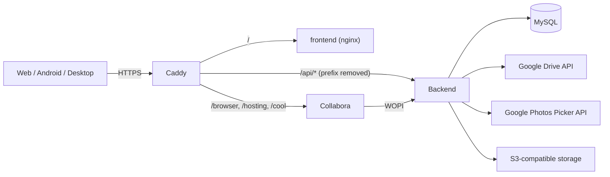

# Architecture

This page explains how the server works: its modules, the data model, and the main background
processes. File paths are relative to `backend/src/`.

## Overview

- **Backend**: Node.js 20, Express 5, TypeScript (ESM), Prisma 6 on MySQL 8. All routes are mounted
  in `app.ts`. The server is stateless apart from the database, a few in-memory job maps (see below)
  and a disk cache for previews.
- **Storage providers**: a `ConnectedAccount` is either `google_drive` or `s3`. Code that reads or
  writes a stored file branches on the provider (`modules/files/stream-file.ts`,
  `modules/google/google.service.ts`, `modules/s3/s3.service.ts`).
- **Clients** all use the same HTTP API with a bearer access token and a refresh token. The Android
  and desktop apps share one API client (`apps/shared/.../data/ApiClient.kt` and `Repository.kt`).

## Modules

| Module (`modules/…`) | Mounted at | What it does |
| --- | --- | --- |
| `auth` | `/auth` | Email/password sign-up and login, Google sign-in (web, desktop loopback, Android native), refresh/logout, email verification, account deletion |
| `connected-accounts` | `/connected-accounts` | Connect Google Drive (OAuth) and S3 buckets, quota sync, Drive import, disconnect |
| `storage` | `/storage` | Pool summary and breakdown, upload routing policy, Free up space (`free-up.ts`, `free-up-photos.ts`) |
| `uploads` | `/uploads` | Multipart uploads and Google resumable (chunked) uploads |
| `files` | `/files`, `/wopi` | List, search, trash, restore, delete, share links, previews and thumbnails, document views, Collabora WOPI host |
| `folders` | `/folders` | Virtual folder tree |
| `public` | `/public` | Public share link pages and downloads (no sign-in) |
| `invites` | `/invites` | Invite people to a file or folder by email |
| `api-keys`, `public-api` | `/api-keys`, `/api/v1/uploads` | API keys (stored hashed, with scopes) and the upload endpoint that uses them |
| `audit-logs` | `/audit-logs` | Activity log (`utils/audit.ts` writes entries) |
| `provider-configs`, `system` | `/provider-configs`, `/system` | Google OAuth client config; admin-only settings (users in `ADMIN_EMAILS`) |

Shared helpers live in `utils/`: `crypto.ts` (AES encryption of stored credentials, token hashing),
`jwt.ts`, `password.ts` (Argon2), `mailer.ts`, `states.ts` (all status values) and `recovery.ts`.

## Data model highlights

The full schema is `backend/prisma/schema.prisma`. Status columns are plain strings; the allowed
values are defined once in `utils/states.ts`.

- **User**: email, Argon2 password hash, `emailVerifiedAt`. Sessions (`UserSession`) store only a
  hash of the refresh token.
- **ProviderConfig**: the Google OAuth client (ID and secret encrypted), redirect URI and scopes.
  The global row (`userId = null`) is used for everyone.
- **ConnectedAccount**: one Google account or S3 bucket of a user. Google access and refresh tokens
  are encrypted. `fullSync = true` means the whole Drive is mirrored (set by the Drive import).
  S3 details (bucket, region, endpoint, encrypted keys, `prefix`, optional `quotaBytes`) are in
  **S3StorageConfig**.
- **StorageAccount**: the last known quota of a connected account (`totalBytes`, `usedBytes`,
  `availableBytes`, `trashBytes`, `lastSyncedAt`). `availableBytes = null` means "unlimited / unknown".
- **Folder**: exists only in the database (`parentId` tree), with colour and icon. Folders imported
  from Google Drive keep their `providerFolderId`.
- **File**: one stored object. `providerFileId` is the Drive file ID or the S3 key. `folderId` is
  Nudge-side only. `takenAt` holds the EXIF capture time used by the photo timeline.
- **FileShare / FilePreviewToken / AuthHandoff / OauthState / EmailVerification**: short or long-lived
  tokens, always stored as hashes.
- **UploadSession**: one upload attempt (see states below). `googleSessionUri` is set for resumable
  Google uploads.
- **UploadRoutingPolicy**: per-user upload rule, priority order and round-robin cursor.
- **AuditLog**, **WorkspaceInvite**, **ApiKey**.

### File status

| `files.status` | Meaning | Shown to the user |
| --- | --- | --- |
| `active` | Normal file | Yes |
| `deleted` | In the Nudge trash. Can be restored; "delete forever" removes it from the provider and deletes the row. A Drive sync never brings it back. | In Trash only |
| `missing` | Gone from the provider outside Nudge Drive (for example deleted in Google Drive). Hidden everywhere. If the file reappears, the next sync makes it `active` again. | No |
| `uploading` | S3 upload in progress. The row exists first so the object key can contain its ID. | No |

The difference between `deleted` and `missing` matters: putting a file that vanished from Drive into
the trash would offer a "restore" of something that no longer exists.

### Upload session status

`uploading` → `completed` | `failed` | `abandoned` (all three are final).

- `failed`: the upload threw an error, or the received byte count did not match the declared size.
- `abandoned`: never finished; closed by the recovery sweep.

## Google Drive sync and import

Nudge Drive writes new Google uploads into a root Drive folder named `Nudge Drive` (set `GOOGLE_APP_FOLDER` to use another name)
(`ensureGoogleAppFolder`).

`syncGoogleAppFolderFiles` (`modules/google/google.service.ts`, triggered by `POST /files/sync-google`
and by the import) brings the database in line with Drive:

1. Only one sync runs per account at a time. A caller that arrives while one runs queues exactly one
   more run; later callers share it. This prevents two runs from creating the same file twice.
2. For `fullSync` accounts, the Drive folder tree is mirrored first (`importDriveFolders`): every
   folder the user owns becomes a Folder row under a "Google Drive · name" root folder.
3. It lists the files: for `fullSync` accounts, every non-trashed file the user owns; otherwise only
   files in the `Nudge Drive` folder and in Drive folders linked to Nudge folders. Temporary preview
   copies are skipped.
4. New files are created with Drive's creation time and the photo's capture time. Changed files are
   updated. Files in the `Nudge Drive` folder keep the Nudge folder the user put them in.
5. A `missing` file that is back on Drive becomes `active` again. A file in the Nudge trash stays there.
   Updates are guarded by the status read at the start, so a trash or delete made during the sync is
   not undone.
6. `active` files that are no longer on Drive become `missing`.
7. The account's quota is refreshed.

**Import on connect**: after a Google account is connected (web OAuth, Google sign-in or Android
native sign-in), `startGoogleDriveImport` sets `fullSync = true` and runs a sync in the background, so
the user sees everything already on that Drive. If the first import fails, the flag is cleared so the
apps can offer the import again. Progress is kept in memory and read via
`GET /connected-accounts/:id/import-status`.

S3 buckets are not synced: Nudge Drive only knows the objects it uploaded under its prefix.

## Uploads and routing

`handleUpload` (`modules/uploads/upload.routes.ts`) serves both `POST /uploads` (signed-in users)
and `POST /api/v1/uploads` (API keys with the `files:upload` scope).

1. The client sends metadata first (`filesMeta` JSON, or `fileName`/`mimeType`/`sizeBytes` fields),
   then the file parts.
2. `selectAccount` picks the destination for each file:
   - Quotas older than 5 minutes are refreshed first.
   - Bytes already reserved by earlier files in the same request are subtracted.
   - Accounts without enough room are skipped; `availableBytes = null` counts as unlimited.
   - The user's rule is applied: **most free space** (default; when quotas are unknown S3 is
     preferred), **round robin** (cursor stored in the database), or **priority** (the user's order).
   - A client may also ask for a specific account.
3. An `UploadSession` row is created (`uploading`).
4. The part is received and its size is checked against the declared size before anything is stored.
5. **Google**: the file is created in the `Nudge Drive` folder (or the linked Drive folder) and given
   "anyone with the link" access, which the apps' Drive links and editors rely on. **S3**: a hidden
   `uploading` File row is created first, the object is uploaded to `<prefix>/<user id>/<file id>/<file name>`,
   then the row becomes `active`.
6. The session becomes `completed` (or `failed`), and the quota is refreshed in the background.
   A failed S3 upload deletes its partial object and placeholder row.

Note that a multipart upload holds the file in the backend's memory before sending it on, so
`MAX_UPLOAD_BYTES` should fit the server's RAM. The web, Android and desktop apps send Google uploads through the resumable route below; S3 uploads use the multipart route.

**Resumable uploads** (Google only): `POST /uploads/resumable/init` picks an account and opens a
Google resumable session; `PUT /uploads/resumable/chunk/:id` streams each chunk straight to Google;
`GET /uploads/resumable/status/:id` returns how much Google has, and finishes the upload if Google
already has the whole file but the reply to the last chunk was lost. Finishing is safe to run twice.

## Free up space

**Google Drive** (`modules/storage/free-up.ts`): empties a full Google Drive by moving its files to
the user's other drives.

- `GET /storage/free-up/:accountId` shows what fills the Drive (by category), what can be moved, and
  where it could go. Gmail and Google Photos share the same 15 GB but are not visible through the Drive API.
- `POST …/start` runs a job, biggest files first. Destination: the user's choice, or automatically the
  Google drive with the most room (so the copy stays inside Google), else S3. Every destination keeps
  a 200 MB safety margin. Google Docs/Sheets/Slides can only move to another Google drive.
- **Google → Google**: the source shares the file with the destination account, the destination
  makes its own copy with `files.copy` (no bytes pass through the server), and the original's link
  sharing is copied. **Google → S3**: the file is streamed through the server.
- The File row is re-pointed at the copy only if it is still the same active file (it may have been
  edited, trashed or deleted meanwhile; then the copy is removed). The original is deleted for good,
  not trashed, so the space comes back at once. If that delete fails, the original is kept in the
  Nudge trash, where "delete forever" retries it.
- The file keeps its ID, folder, shares and previews, so nothing changes for the user except where it lives.
- `POST …/empty-trash` empties Google's Drive trash and the Nudge trash for that account.
- One job per account at a time; jobs live in memory (`status`, `cancel`, clear).

**Google Photos** (`modules/storage/free-up-photos.ts`): the Drive API cannot see Google Photos, and
no app may delete from it. Instead:

1. The user grants the `photospicker.mediaitems.readonly` scope for that account.
2. `POST …/photos/session` opens a Google Photos Picker session; the app shows Google's picker.
3. `POST …/photos/start` copies the picked originals to the user's other drives, into a
   "Google Photos · name" folder. Items copied by an earlier run (same name and capture time) are skipped.
4. The apps then guide the user through deleting those photos in Google Photos (showing the dates
   they were taken), which is what frees the space.

## Recovery sweep

`utils/recovery.ts` runs at startup and then every hour (`startRecoverySweep` in `server.ts`). A crash
or restart in the middle of an upload would otherwise leave work in `uploading` forever:

- Upload sessions still `uploading` after 24 hours (7 days for Google resumable sessions, which Google
  keeps open for a week) become `abandoned`.
- S3 placeholder File rows still `uploading` after 24 hours are removed, along with any partial object.

## Previews and editing

- `modules/files/previews.ts`: thumbnails (Google's own thumbnail at the requested size) and PDF
  previews of office documents (converted by Google from a temporary copy that is deleted afterwards).
- `modules/files/office.ts`: sheet data and reflowable HTML for the mobile viewers, Google Docs edit
  links, and creating new Google documents.
- `modules/files/preview-cache.ts`: disk cache for the above, capped at 1 GB (`PREVIEW_CACHE_DIR`).
- `modules/files/wopi.ts`: WOPI host for Collabora Online (CheckFileInfo, GetFile, PutFile) with
  short-lived signed access tokens. Google Docs/Sheets/Slides are edited as .docx/.xlsx/.pptx and
  written back into the same Google file, so they stay Google files.

## Authentication details

- Access tokens are JWTs (`JWT_ACCESS_SECRET`); refresh tokens are random and stored hashed.
- Google sign-in never puts app tokens in a URL: the OAuth callback creates a one-time hand-off token
  (5 minutes) that the client exchanges at `POST /auth/google/exchange`.
- The desktop app signs in through the system browser and receives the hand-off token on a loopback
  address (`http://127.0.0.1:<port>/google-auth`); the port is bound to the OAuth state.
- The Android app uses the phone's account picker and sends a one-time server auth code to
  `POST /auth/google/native`, which is exchanged with the same web OAuth client.
- Email verification sends a 6-digit code and a one-tap link when SMTP is configured.
- Account deletion revokes the stored Google tokens (best effort) and deletes the user and every
  related row. Files stay in the user's own storage.
